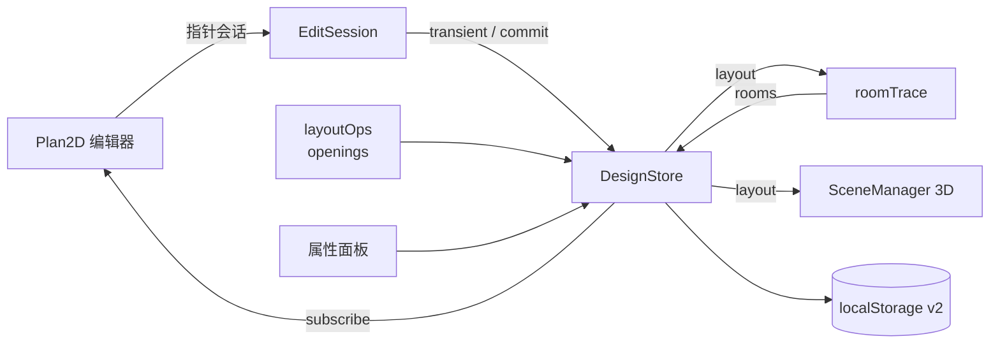

# 户型图编辑器 · 技术方案

| 项目 | 内容 |
|---|---|
| 文档版本 | v0.1（草案） |
| 编写日期 | 2026-11-05 |
| 适用项目 | HomeRoom（React + TypeScript + Vite + three.js） |
| 关联文档 | [户型编辑器-需求规格](./户型编辑器-需求规格.md) |

## 1. 设计目标与关键决策

### 1.1 目标

把户型几何从静态资源升级为可编辑、可撤销、可持久化的文档，并保证 2D 与 3D 只有一套几何来源。

### 1.2 关键决策

| 决策 | 方案 | 理由 |
|---|---|---|
| 墙体模型 | 轴对齐矩形 + `lineId` 墙线分组 | 复用现有 2D/3D 矩形渲染，同时支持整条墙线移动、改厚度、改类型 |
| 门窗模型 | 存放在墙线上的区间（`span + band`），矩形由派生得到 | 位置、宽度、开向只有一份数据，避免门窗与墙段失配 |
| 房间模型 | 由墙体围合自动识别，名称/材质按重叠匹配保留 | 墙体变化后房间数量、大小、面积自动跟随 |
| 编辑单位 | 墙线（wall line），而不是单个墙块 | 选中、移动、改厚度时整条墙线一致，避免出现孤立墙块 |
| 撤销 | 复用现有 `DesignState` 快照 | 墙体、门窗、房间全部自动纳入撤销栈 |
| 3D 同步 | 布局签名 + 提交后防抖重建 | 拖拽期间不逐帧重建，提交后一次重建 |

## 2. 现状与改造点

| 文件 | 现状 | 改造 |
|---|---|---|
| `src/types.ts` | 墙体/门窗/房间为只读结构，`Tool` 只有 3 种 | 增加 `lineId`、`OpeningData`、扩展 `Tool` / `Selection` |
| `src/lib/plan.ts` | 静态导入 `floorplan.json`，全局单例 `plan` | 拆为默认模板 + 静态材质目录；户型从 store 读取 |
| `src/lib/store.ts` | `DesignState` 只含家具/房间覆盖/拆改/测量 | 加入 `layout: PlanDoc`，升级存储键与迁移逻辑 |
| `src/components/Plan2D.tsx` | 只渲染静态户型，墙体下标 ID | 按 `layout` 渲染；新增墙体/房间/门窗工具、手柄、预览 |
| `src/components/Panel.tsx` | 仅家具与房间属性 | 增加墙线、门、窗、推拉门属性 |
| `src/components/Header.tsx` | 3 个 2D 工具 | 扩展工具组与快捷键 |
| `src/three/scene.ts` | 从静态 `plan` 构建建筑，签名不含户型 | 从 `store.layout` 构建；签名加入户型；订阅重建 |
| `src/App.tsx` | 导入导出仅包含装修状态 | 导入导出包含完整户型；拆改变为墙线粒度 |
| `src/lib/snap.ts` | 仅家具/测量吸附 | 增加墙端点、墙面、洞口边、墙线延长线吸附 |

## 3. 总体架构



分层职责：

| 层 | 模块 | 职责 |
|---|---|---|
| 交互层 | `Plan2D` + `EditSession` | 指针事件、预览、手柄、吸附调用 |
| 操作层 | `layoutOps` / `openings` | 墙线、洞口、房间的原子操作与约束 |
| 推导层 | `roomTrace` / `derive*` | 房间识别、门窗矩形、门开向派生 |
| 状态层 | `store` / `planDoc` | 快照、撤销、持久化、迁移、校验 |
| 展现层 | `Plan2D` / `SceneManager` / `Panel` | 2D、3D、属性面板 |

数据流：指针 → 会话 → 瞬态变更 → 松手提交 → 房间刷新 → 通知订阅者 → 2D/3D 重建。

## 4. 数据模型

```ts
export type WallKind = 'b' | 'e' | 'n' | 'low';
export type Point = [number, number];
export type Axis = 'h' | 'v';

/** 墙块：保持轴对齐矩形，lineId 表示它属于哪条墙线 */
export interface WallData {
  id: string;
  lineId: string;
  x0: number; y0: number; x1: number; y1: number;
  kind: WallKind;
}

/** 墙线视图（运行时派生，不持久化） */
export interface WallLineView {
  id: string;
  axis: Axis;
  kind: WallKind;
  band: [number, number];   // 厚度方向范围
  span: [number, number];   // 长度方向范围
  segments: WallData[];
  openings: OpeningData[];
}

/** 门窗洞口：位于某条墙线的区间 */
export interface OpeningData {
  id: string;
  lineId: string;
  kind: 'door' | 'window' | 'slide';
  span: [number, number];     // 沿墙线方向，绝对坐标
  sill?: number;              // 窗台高
  head?: number;              // 窗头 / 门头高
  hingeEnd?: 'start' | 'end'; // 门：铰链靠 span 的哪一端
  swing?: 1 | -1;             // 门：向墙带哪一侧开启
  entry?: boolean;            // 入户门
}

/** 房间：几何由墙体推导，名称/材质/统计随房间保留 */
export interface RoomData {
  id: string;
  name: string;
  nameEn: string;
  mat: string;
  poly: Point[];
  labelAt?: Point;
  counted?: boolean;
}

export interface PlanDoc {
  schemaVersion: 2;
  bounds: { x: number; y: number; w: number; h: number };
  origin: Point;
  floorHeight: number;
  walls: WallData[];
  openings: OpeningData[];
  rooms: RoomData[];
  dimensionChains: DimensionChains;
}

export interface DesignState {
  layout: PlanDoc;
  furniture: Furniture[];
  demolished: string[];   // 墙块 ID
  measures: Measure[];
}
```

说明：

- `materials`、`catalog`、`initialFurniture` 属于静态模板，不进入 `PlanDoc`。
- 房间名称与材质从旧的 `DesignState.rooms` 合并进 `PlanDoc.rooms`，因为房间本身可增删。
- `WallLineView` 每次由 `walls` 按 `lineId` 聚合得到，持久化层不保存冗余视图。

## 5. 状态管理与持久化

### 5.1 Store

复用现有 `DesignStore`：

- `mutate`：记录一次可撤销操作；用于新增/删除墙线、改厚度、插门窗等。
- `applyTransient`：拖拽中的高频更新，不写历史。
- `commit(before)`：松手后一次性入栈。
- `cancel(before)`：`Esc` 或非法操作时回滚。

`DesignState` 顶层新增 `layout` 后，现有快照（`JSON.stringify(state)`）自动覆盖户型。

### 5.2 存储与迁移

| 项 | 方案 |
|---|---|
| 新存储键 | `homeroom-design-v2` |
| 旧键读取 | `homeroom-design-v1`，仅当 v2 不存在时迁移 |
| 迁移内容 | ① 为墙块补 `id` / `lineId`；② 门窗转 `OpeningData`；③ 旧的 `state.rooms` 合并进 `layout.rooms`；④ `demolished` 的 `w0` 下标映射为墙块 ID |
| 迁移失败 | 回退默认模板，保留家具数据，提示用户 |
| 导出 | `{ schemaVersion: 2, layout, furniture, demolished, measures }` |
| 导入 | `normalizePlanDoc` 校验并修复；非法字段回退默认值 |

### 5.3 墙线分组规则

迁移时按下列条件把墙块分到同一条墙线：

1. 轴向一致（水平 / 垂直）；
2. 厚度方向范围一致（`band` 相同，容差 1mm）；
3. 类型一致；
4. 首尾相接，或被同一个门窗洞口隔开。

不满足条件的墙块单独成线。新建墙体默认一条墙线一个墙块。

## 6. 几何内核

### 6.1 墙线操作（`layoutOps.ts`）

| 方法 | 行为 |
|---|---|
| `createWallLine(a, b, thickness, kind)` | 端点吸附 + 正交约束，生成墙线与首个墙块 |
| `moveWallLine(lineId, dx, dy)` | 平移整条墙线的所有墙块与洞口 |
| `resizeWallLine(lineId, end, coord)` | 只改墙线外侧端点；遇洞口夹紧，保证墙垛 ≥ 100mm |
| `setLineThickness(lineId, t)` | 保持墙线中心不变，更新所有墙块与洞口的 `band` |
| `setLineKind(lineId, kind)` | 更新墙线内全部墙块类型 |
| `deleteWallLine(lineId)` | 删除墙线、墙块与洞口，清理拆改记录 |
| `splitWallSegment(segmentId, at)` | 插入洞口时切分墙块，继承 `lineId` / `kind` |
| `mergeWallSegments(aId, bId)` | 删除洞口后合并相邻同类型墙块 |

墙线不变量：

- 同一 `lineId` 的墙块轴向、`band`、`kind` 一致；
- 墙块之间不重叠，可以相接；
- 墙线 `span = [min(墙块/洞口), max(墙块/洞口)]`；
- 墙线外侧端点手柄只在最外侧墙块上出现；
- 改厚度时墙线中心线不变。

### 6.2 洞口操作（`openings.ts`）

| 方法 | 行为 |
|---|---|
| `insertOpening(lineId, kind, center, width)` | 在墙块中切出洞口，生成左右墙块与洞口 |
| `moveOpening(id, delta)` | 沿墙线平移；同步调整左右墙块端点 |
| `resizeOpening(id, edge, coord)` | 调整洞口一端；限制最小墙垛与最大宽度 |
| `removeOpening(id)` | 删除洞口，合并左右墙块 |
| `setOpeningSillHead(id, sill, head)` | 更新窗标高；校验 `sill < head ≤ floorHeight` |
| `setDoorSwing(id, hingeEnd, swing)` | 更新门开向参数 |

洞口约束：

- `span` 必须落在墙线 `span` 内；
- `band` 必须与墙线 `band` 一致；
- 同一墙线上洞口不重叠，洞口之间至少 100mm；
- 洞口两侧若存在墙块，墙垛 ≥ 100mm；
- 门窗宽度按需求规格第 7 节的取值夹紧。

### 6.3 门窗派生

```ts
/** 洞口 → 矩形，用于 2D 绘制与 3D 洞口 */
export function openingRect(line: WallLineView, o: OpeningData): [number, number, number, number] {
  const [s0, s1] = o.span;
  const [c0, c1] = line.band;
  return line.axis === 'h' ? [s0, c0, s1, c1] : [c0, s0, c1, s1];
}

/** 门参数 → 门扇实例（兼容现有 DoorData 渲染字段） */
export function doorRender(line: WallLineView, o: OpeningData): DoorRender {
  const [s0, s1] = o.span;
  const [c0, c1] = line.band;
  const hingeAt = o.hingeEnd === 'start' ? s0 : s1;
  const other = o.hingeEnd === 'start' ? s1 : s0;
  const c = (c0 + c1) / 2;
  const hinge: Point = line.axis === 'h' ? [hingeAt, c] : [c, hingeAt];
  const closedDir = normalize(
    line.axis === 'h' ? [other - hingeAt, 0] : [0, other - hingeAt],
  );
  const swing = o.swing ?? 1;
  const openDir = normalize(line.axis === 'h' ? [0, swing] : [swing, 0]);
  return { hinge, closedDir, openDir, len: Math.abs(s1 - s0), entry: !!o.entry };
}
```

2D 弧线与 3D 门扇角度都从 `DoorRender` 生成，禁止在组件内重复推导。

### 6.4 吸附（`snap.ts`）

在现有 `snapMove` / `snapPoint` 之上新增：

| 函数 | 用途 |
|---|---|
| `snapWallPoint(p, shift, ctx)` | 画墙端点吸附：墙线端点、墙块角点、洞口边、延长线、网格 |
| `snapOpeningCenter(p, line)` | 门窗点击位置吸附到墙块中心、洞口边、网格 |
| `clampOpeningSpan(line, span, minPier)` | 洞口夹紧与最小墙垛校验 |
| `projectToLine(p, line)` | 将任意点投影到墙线，用于沿墙拖动 |

吸附容差统一按 `px / viewScale` 换算，命中时返回吸附点与参考线，供预览层绘制。

## 7. 房间识别

### 7.1 算法

文件：`src/lib/roomTrace.ts`

1. 根据 `layout.bounds` 外扩 1m 建立栅格，分辨率 25mm。
2. 把所有墙块、门窗洞口矩形栅格化为障碍（门窗封住，避免房间互串）。
3. 从给定种子点做 4 邻域洪泛，得到连通域。
4. 对连通域做 marching squares 提轮廓。
5. 用 RDP（epsilon 20–30mm）简化轮廓。
6. 顶点在 50mm 内可吸附到邻近墙面时，贴合到墙面。
7. 面积小于 0.5m² 的连通域忽略。
8. 计算内部点：取连通域内距障碍最远的栅格中心，避免凹多边形质心落在墙外。

### 7.2 全屋刷新与匹配

```ts
interface RoomMatch {
  oldId?: string;
  overlap: number; // 0..1
}
```

- 对所有连通域生成候选房间。
- 用栅格重叠统计：旧房间栅格落入新连通域的比例。
- 取重叠最大的旧房间继承 `id / name / mat / counted`。
- 未匹配的新房间：分配新 ID，名称 `房间 N / Room N`，材质默认 `tile800`。
- 旧房间没有匹配到任何新连通域：删除。
- 每个墙线/洞口提交后执行一次；拖拽过程中不执行。

### 7.3 房间属性

- 名称、材质、是否计入套内仍可编辑，写入 `layout.rooms`。
- 面积由 `areaOf(poly)` 计算，2D 与 3D 标签共用。
- 房间数量由墙体拓扑决定，不提供脱离墙体的手动房间；拆除/新增共享墙即可合并/拆分。

## 8. 2D 编辑器

### 8.1 工具与状态机

```ts
type Tool =
  | 'select' | 'wall' | 'room' | 'door' | 'window' | 'slide'
  | 'measure' | 'demolish';

type EditSession =
  | { kind: 'idle' }
  | { kind: 'drawWall'; a: Point; b: Point; before: string }
  | { kind: 'drawRoom'; a: Point; b: Point; before: string }
  | { kind: 'dragLine'; lineId: string; part: 'body' | 'start' | 'end' | 'thickness'; before: string }
  | { kind: 'placeOpening'; tool: 'door' | 'window' | 'slide'; lineId: string; span: [number, number] }
  | { kind: 'dragOpening'; id: string; part: 'body' | 'start' | 'end'; before: string }
  | { kind: 'drawMeasure'; a: Point; b: Point };
```

规则：

- 所有拖拽开始前调用 `store.snapshot()` 存入 `before`；
- 移动过程调用 `store.applyTransient`；
- 松手调用 `store.commit(before)`；
- `Esc` 调用 `store.cancel(before)` 并回到 `idle`；
- 非法操作（墙太短、洞口越界）不提交，显示提示。

### 8.2 渲染层顺序

1. 背景网格；
2. 房间地面材质；
3. 门洞 / 推拉门门槛；
4. 家具；
5. 墙体墙块；
6. 窗、门、推拉门符号；
7. 房间标签与面积；
8. 尺寸链；
9. 测量；
10. 选中高亮与手柄；
11. 编辑预览（幽灵墙、幽灵洞口、吸附点）。

### 8.3 命中与手柄

- 墙体：为每个墙块增加透明命中矩形，屏幕厚度不小于 8px；命中后选择整条墙线。
- 墙线手柄：
  - 两个外侧端点（改长度）；
  - 墙体一侧中点（改厚度）；
  - 墙身（整体移动）。
- 洞口手柄：两端各一个改宽手柄，主体用于沿墙拖动。
- 触屏下将手柄命中半径放大到约 24px。

### 8.4 预览

| 操作 | 预览 |
|---|---|
| 画墙 | 半透明墙体 + 长度标注 + 吸附点 |
| 快速建房 | 半透明矩形 + 四边墙体轮廓 |
| 插入门窗 | 洞口矩形 + 门窗符号 + 宽度标注 |
| 沿墙拖动门窗 | 洞口跟随，显示距墙端距离 |
| 改长度 | 端点跟随，显示实时长度与是否越界 |

## 9. 属性面板与工具栏

### 9.1 墙线属性

- 长度（只读，由 span 计算）；
- 厚度（输入或预设 120 / 200 / 240）；
- 类型（承重 / 外墙 / 隔墙 / 矮墙）；
- 洞口数量；
- 删除墙线。

### 9.2 门属性

- 宽度；
- 距墙线起始端距离；
- 门头高；
- 入户门开关；
- 铰链端：起始 / 结束；
- 开启侧：内 / 外；
- 四态可视化按钮；
- 删除。

### 9.3 窗属性

- 宽度；
- 距墙线起始端距离；
- 窗台高、窗头高；
- 删除。

### 9.4 推拉门属性

- 宽度；
- 距墙线起始端距离；
- 推拉面方向；
- 删除。

### 9.5 工具栏

- 2D 工具组：选择、墙体、房间、门、窗、推拉门、测量、拆改。
- 保留原有缩放、比例、图层面板、撤销/重做。
- 新增编辑图层面板开关：墙线、门窗、房间、家具、尺寸、网格。

## 10. 3D 联动

### 10.1 同步签名

`SceneManager.sync` 的签名增加户型数据：

```ts
const sigPlan = JSON.stringify([
  layout.walls, layout.openings, layout.rooms,
  state.demolished, this.opt.cut,
]);
if (force || sigPlan !== this.sigPlan) {
  this.sigPlan = sigPlan;
  this.buildArch();
}
```

### 10.2 构建规则

- 墙体：由墙块矩形直接生成 `BoxGeometry`；
- 门窗洞口：洞口上方的过梁、窗台、玻璃、框料按 `openingRect` 位置生成；
- 门扇：由 `doorRender` 得到 `hinge / closedDir / openDir / len`，生成枢轴组；
- 地面：按 `layout.rooms` 多边形生成，材质由房间属性决定；
- 碰撞体：由墙块矩形生成，供漫游碰撞；
- 标签：由 `layout.rooms` 的 `labelAt` 生成。

### 10.3 重建策略

- 2D 拖拽过程中不调用 `sync`；
- 提交后通过 store 订阅触发，使用 150–250ms 防抖；
- 重建前 dispose 旧几何与材质；
- 门开合动画依赖的 `doors` 数组在重建时同步刷新。

## 11. 文件改动清单

### 11.1 新增

| 文件 | 职责 |
|---|---|
| `src/lib/planDoc.ts` | 默认户型、迁移、规范化、校验 |
| `src/lib/layoutOps.ts` | 墙线分组、增删改、墙块拆分合并 |
| `src/lib/openings.ts` | 洞口增删改、门窗矩形与门开向派生 |
| `src/lib/roomTrace.ts` | 栅格洪泛、轮廓提取、房间匹配 |

### 11.2 修改

| 文件 | 改动 |
|---|---|
| `src/types.ts` | 新数据模型、`Tool` / `Selection` 扩展 |
| `src/lib/plan.ts` | 移除静态 `plan` 单例，保留静态目录与模板 |
| `src/lib/store.ts` | `layout` 入状态、v2 存储键、迁移入口 |
| `src/lib/snap.ts` | 墙线/洞口/端点吸附 |
| `src/components/Plan2D.tsx` | 按 `layout` 渲染、编辑会话、手柄、预览 |
| `src/components/Panel.tsx` | 墙线/门/窗/推拉门属性 |
| `src/components/Header.tsx` | 工具与图层扩展 |
| `src/components/Library.tsx` | 房间列表从 `layout.rooms` 读取 |
| `src/App.tsx` | 状态装配、导入导出、面积统计、快捷键 |
| `src/three/scene.ts` | 从 `layout` 构建、签名、订阅、门开向 |
| `src/styles.css` | 手柄、预览、命中层样式 |

## 12. 实施阶段

### P0 数据基础

任务：

1. 扩展 `types.ts`：`lineId`、`OpeningData`、`Tool`、`Selection`。
2. 新建 `planDoc.ts`：默认模板、v1→v2 迁移、规范化、校验。
3. `store.ts` 接入 `layout`，存储键升级 v2。
4. 移除 `plan.ts` 静态单例，改造所有引用点。
5. 导入导出升级到 v2。
6. 旧存档迁移后 `npm run build` 通过。

验收：旧存档加载不丢家具/材质/拆改；刷新恢复；导入导出往返一致。

### P1 墙线与房间

任务：

1. `layoutOps.ts`：墙线分组、创建、移动、改长、改厚、改类型、删除。
2. `snap.ts`：墙线端点、墙面、洞口边、延长线吸附。
3. `Plan2D.tsx`：墙体工具、墙线选择、端点/厚度手柄、预览。
4. 房间工具：拖矩形快速建房。
5. `roomTrace.ts`：洪泛识别、轮廓简化、名称/材质匹配。
6. `Panel.tsx`：墙线与房间属性；`Header.tsx`：工具按钮。

验收：AC-01 ~ AC-04、AC-08、AC-11。

### P2 门窗与开向

任务：

1. `openings.ts`：插入、移动、改宽、删除、标高、开向参数。
2. 门的 `doorRender` 派生与 2D 弧线。
3. 门窗工具、沿墙拖动、两端手柄、预览。
4. 壁龛/墙垛/洞口间距校验。
5. 属性面板四态开向按钮。

验收：AC-05 ~ AC-07、AC-10。

### P3 3D 与打磨

任务：

1. `scene.ts`：布局签名、按 `layout` 重建建筑、门开向、碰撞体。
2. store 订阅 + 防抖 + 几何释放。
3. 中英文文案、错误提示、吸附提示。
4. 性能检查与回归测试。

验收：AC-09、AC-11；3D 与 2D 完全一致。

## 13. 测试计划

### 13.1 纯函数测试（建议引入 Vitest）

| 模块 | 用例 |
|---|---|
| `layoutOps` | 创建墙线、移动、改长夹紧、改厚度保持中心、删除清理 |
| `openings` | 插入切分、移动调整邻段、改宽、删除合并、越界拒绝 |
| `doorRender` | 四种开向组合的 hinge/closedDir/openDir |
| `roomTrace` | 矩形房间、L 形房间、门洞不漏、面积与重叠匹配 |
| 迁移 | 旧 `w0` 拆改映射、门窗转洞口、房间覆盖合并 |

若暂不引入测试框架，至少保证上述函数为纯函数，并提供可复现手测清单。

### 13.2 手测用例

| 编号 | 操作 | 期望 |
|---|---|---|
| T-01 | 画墙 | 正交、吸附、长度正确、可撤销 |
| T-02 | 拖端点 | 长度变化，遇洞口夹紧 |
| T-03 | 改厚度 | 墙线与洞口同步，中心不变 |
| T-04 | 快速建房 | 四面墙 + 一个房间 |
| T-05 | 加隔墙 | 房间拆分，面积更新 |
| T-06 | 删共享墙 | 房间合并，名称保留 |
| T-07 | 插窗并拖动 | 洞口跟随，墙段伸缩 |
| T-08 | 插门并改宽 | 洞口与墙段同步 |
| T-09 | 四态开向 | 2D 弧线与 3D 门扇一致 |
| T-10 | 刷新/导入导出 | 数据完整往返 |
| T-11 | 旧存档迁移 | 家具、材质、拆改保留 |
| T-12 | 构建 | `npm run build` 通过 |

## 14. 风险与对策

| 风险 | 影响 | 对策 |
|---|---|---|
| 旧墙块分组错误 | 墙线移动/改厚度波及错误墙块 | 分组条件严格限制轴向、band、kind；迁移后可视化校验 |
| 墙块/洞口 ID 变化导致拆改记录失效 | 旧拆改状态丢失 | 迁移时映射；每次布局提交后清理失效 ID |
| 房间重算丢失名称/材质 | 用户体验受损 | 按栅格重叠匹配，最大重叠继承属性 |
| 洞口与相邻墙段失配 | 出现缝隙或重叠 | 所有操作只走 `openings.ts`，统一重算邻段 |
| 3D 重建卡顿/显存泄漏 | 交互卡顿 | 拖拽不重建、提交防抖、dispose 旧几何 |
| 静态 `plan` 引用遗漏 | 新旧数据源不一致 | P0 全量替换，TypeScript 编译期检查 |
| 低缩放吸附失效 | 难以精确编辑 | 吸附容差按屏幕像素换算；编辑时限制最小缩放 |
| 房间识别近似误差 | 面积与轮廓不完全精确 | 25mm 栅格 + 贴墙吸附；明确为近似识别 |

## 15. 附录

### 15.1 默认参数

| 参数 | 默认值 |
|---|---|
| 网格 | 10mm |
| 墙厚 | 200mm |
| 门宽 | 900mm |
| 窗宽 | 1200mm |
| 推拉门宽 | 2000mm |
| 门头高 | 2100mm |
| 窗台高 | 900mm |
| 窗头高 | 2400mm |
| 最小墙垛 | 100mm |
| 最小墙长 | 100mm |
| 房间最小面积 | 0.5m² |
| 栅格分辨率 | 25mm |

### 15.2 迁移映射

| 旧数据 | 新数据 |
|---|---|
| `walls[i]` | `WallData { id: 'w' + i, lineId: 分组结果 }` |
| `doors[i].rect` | `OpeningData { kind: 'door', span, band }` |
| `doors[i].hinge` | `hingeEnd`（距 span 端点更近者） |
| `doors[i].openDir` | `swing`（按墙带法线方向取符号） |
| `windows[i]` | `OpeningData { kind: 'window', span, band, sill, head }` |
| `slides[i]` | `OpeningData { kind: 'slide', span, band }` |
| `state.rooms[id]` | 合并进 `layout.rooms[id].name / mat` |
| `state.demolished` 的 `w0` | 迁移后墙块 `id`（保持 `w0` 命名即可直接对应） |

### 15.3 核心 API 草案

```ts
// layoutOps.ts
createWallLine(a: Point, b: Point, thickness: number, kind: WallKind): string;
moveWallLine(lineId: string, dx: number, dy: number): void;
resizeWallLine(lineId: string, end: 'start' | 'end', coord: number): boolean;
setLineThickness(lineId: string, thickness: number): void;
deleteWallLine(lineId: string): void;
groupLines(layout: PlanDoc): WallLineView[];
lineOf(layout: PlanDoc, lineId: string): WallLineView | null;

// openings.ts
insertOpening(layout: PlanDoc, lineId: string, kind: OpeningKind, center: number, width: number): string | null;
moveOpening(layout: PlanDoc, id: string, delta: number): boolean;
resizeOpening(layout: PlanDoc, id: string, edge: 'start' | 'end', coord: number): boolean;
removeOpening(layout: PlanDoc, id: string): void;
openingRect(line: WallLineView, o: OpeningData): [number, number, number, number];
doorRender(line: WallLineView, o: OpeningData): DoorRender;

// roomTrace.ts
traceRoom(layout: PlanDoc, seed: Point): Point[] | null;
refreshRooms(layout: PlanDoc, prev: RoomData[]): RoomData[];
```

## 16. 变更记录

| 版本 | 日期 | 说明 |
|---|---|---|
| v0.1 | 2026-11-05 | 初稿：数据模型、墙线/洞口/房间算法、交互与实施阶段 |
